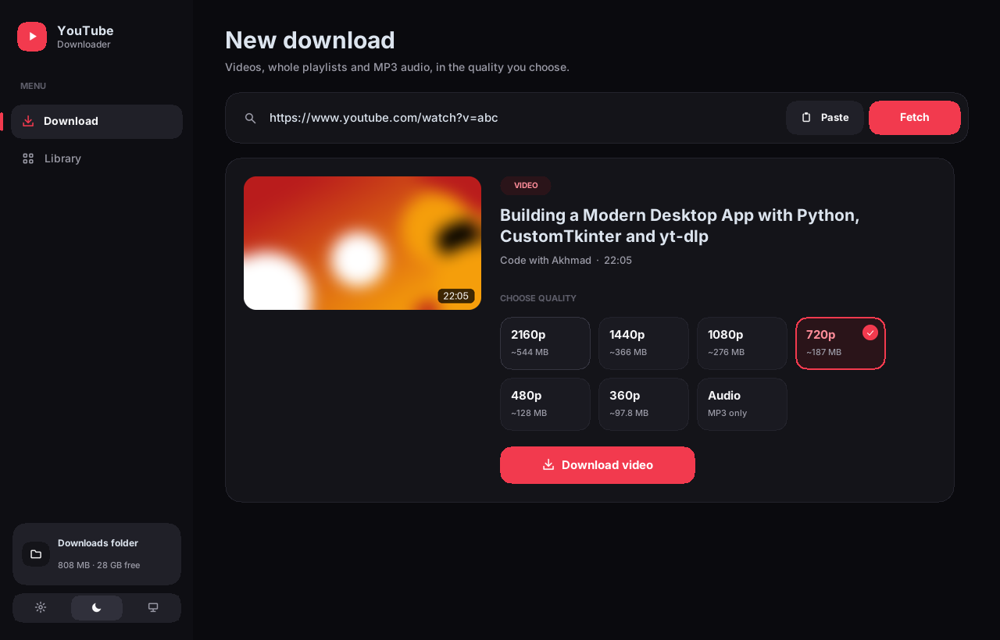
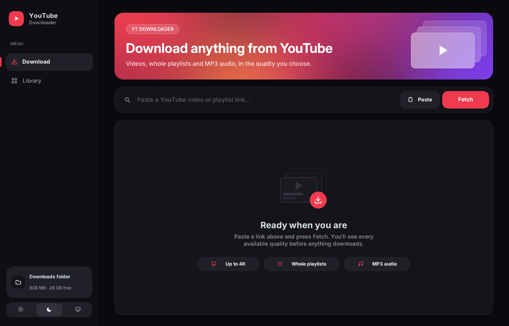
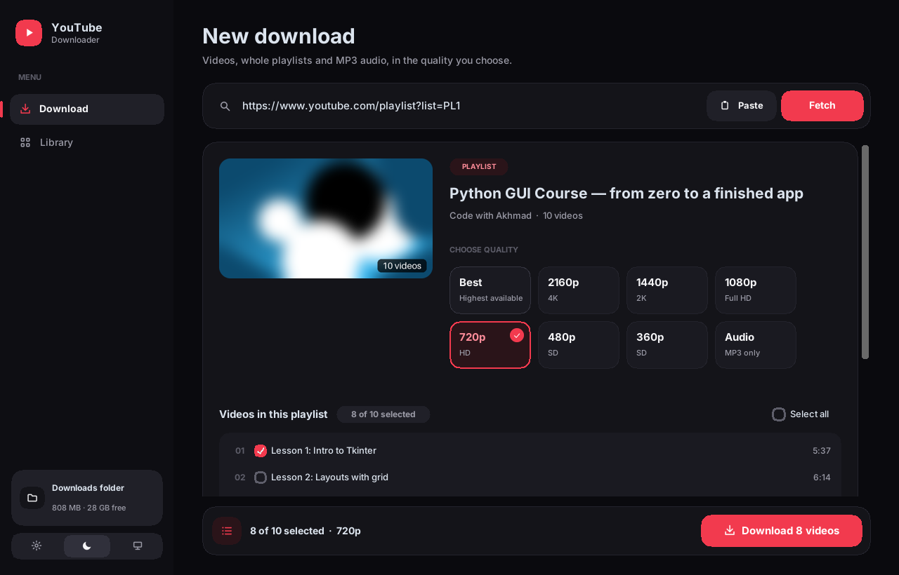
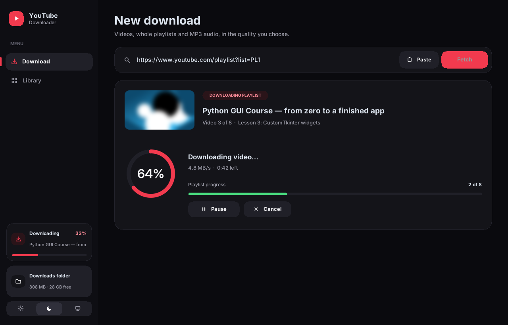
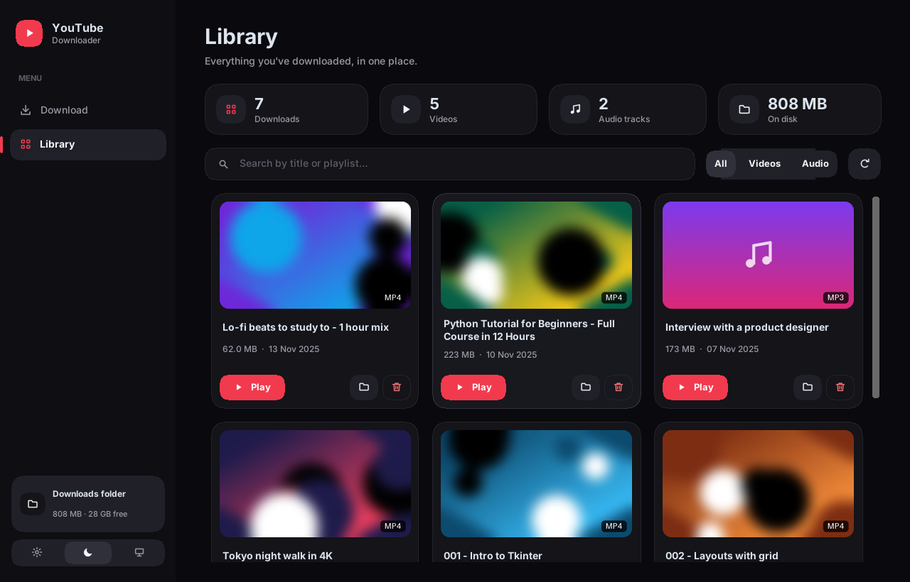
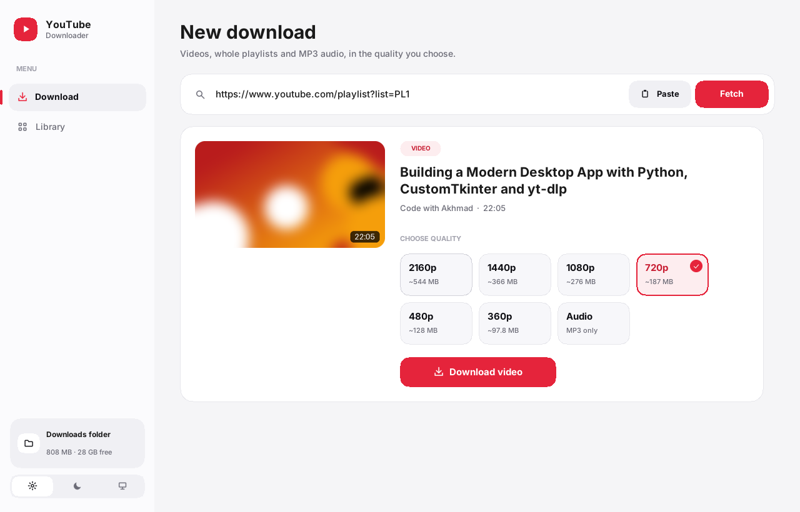

# 🚀 YouTube Video Downloader Pro

Ushbu loyiha YouTube platformasidan videolarni tezkor va qulay tarzda yuklab olish uchun yaratilgan zamonaviy desktop ilovadir. Python va CustomTkinter texnologiyalari asosida qurilgan bo'lib, u foydalanuvchiga yuqori darajadagi interfeys va barqaror ish faoliyatini taqdim etadi.



## 🖼 Ekran rasmlari

| Bosh sahifa | Playlistdan tanlash |
|---|---|
|  |  |
| **Yuklash jarayoni** | **Kutubxona** |
|  |  |
| **Yorug' rejim** | **Sifatni tanlash** |
|  |  |

## ✨ Asosiy Imkoniyatlar (Features)

* **Video va playlist yuklash:** Havolani joylashtiring, *Fetch* tugmasini bosing — dastur video yoki playlistni aniqlab, oldindan ko'rinishini (muqova, nom, kanal, davomiylik) ko'rsatadi.
* **Sifat tanlash:** Video uchun mavjud barcha sifatlar (masalan 1080p, 720p, 480p) taxminiy hajmi bilan ro'yxatda ko'rsatiladi; standart tanlov — 720p. Faqat audio (MP3) ham yuklash mumkin.
* **Playlistdan tanlab yuklash:** Playlistdagi videolar ro'yxati belgilash katakchalari bilan chiqadi — keraklilarini tanlang yoki hammasini yuklang. Playlist videolari alohida papkaga tartib raqami bilan saqlanadi; mavjud bo'lmagan videolar o'tkazib yuboriladi.
* **Jonli jarayon:** Bosqich (video, audio, birlashtirish), foiz, tezlik, qolgan vaqt va playlistdagi joriy video ("Video 3 of 12") ko'rsatiladi. Yuklashni istalgan payt bekor qilish mumkin.
* **Pauza va davom ettirish:** Yuklashni istalgan payt *Pause* bilan to'xtatib, *Resume* bilan to'xtagan joyidan davom ettirish mumkin (boshidan emas). Internet uzilsa yoki aloqa juda sekinlashib qotib qolsa, yuklash avtomatik pauza qilinadi va internet qaytgach o'zi davom etadi.
* **Kutubxona:** Yuklangan fayllar muqovali kartochkalar to'rida (oyna kengligiga moslashadi); qidiruv, *Barchasi / Video / Audio* filtri, ijro etish (*Play*), papkada ko'rsatish va tasdiqlab o'chirish.
* **Zamonaviy dizayn:** Yon panel (Download / Library), sifatni tanlash kartochkalari, yumaloq muqovalar, o'z chizilgan ikonkalar va bildirishnomalar (toast). Yuklash davom etayotganda yon panelda jonli holat ko'rinadi.
* **Yorug' / Qorong'i rejim:** Yon paneldagi ☀ / ☾ / 🖥 tugmalari bilan Light, Dark yoki System mavzusi.
* **Barqaror interfeys:** Barcha yuklash ishlari fon oqimida bajariladi, interfeys qotib qolmaydi.

## 🛠 Texnologik Stack

* **Python 3.12+:** Asosiy dasturlash tili.
* **CustomTkinter:** Zamonaviy va "Dark Mode" qo'llab-quvvatlaydigan UI elementlari.
* **yt-dlp:** Video yuklash uchun kutubxona.
* **ffmpeg:** Video va audio oqimlarini birlashtirish uchun (tavsiya etiladi).
* **uv:** Kutubxonalar va virtual muhitni boshqarish.

## 📥 O'rnatish va Ishga Tushirish

1.  **Loyiha nusxasini oling (Clone):**
    ```bash
    git clone https://github.com/akhmadjonakbarov/YouTube-VideoDownloader.git
    cd YouTube-VideoDownloader
    ```

2.  **ffmpeg o'rnating (720p uchun kerak):**
    ```bash
    # macOS
    brew install ffmpeg
    # Windows
    winget install ffmpeg
    # Linux (Debian/Ubuntu)
    sudo apt install ffmpeg
    ```
    ffmpeg bo'lmasa, dastur ishlaydi, lekin faqat bitta fayldan iborat formatlarni (ko'pincha 360p) yuklaydi.

3.  **Kutubxonalarni o'rnating** ([uv](https://docs.astral.sh/uv/) orqali):
    ```bash
    uv sync
    ```

4.  **Dasturni ishga tushiring:**
    ```bash
    uv run python src/app.py
    ```

5.  **Testlarni ishga tushirish:**
    ```bash
    uv run pytest
    ```

Videolar `~/Downloads/Youtube Videos` papkasiga saqlanadi.

PyCharm'da `src` papkasini **Sources Root** deb belgilang (o'ng tugma → *Mark Directory as* → *Sources Root*) va `src/app.py` ni ishga tushiring.

## 📦 Tayyor dastur yasash (macOS, Windows, Linux)

Dastur PyInstaller yordamida mustaqil ilovaga aylantiriladi: foydalanuvchiga Python, ffmpeg yoki Deno o'rnatish shart emas — ularning hammasi ilova ichiga qo'shiladi.

> **Muhim:** 2025-yil oxiridan boshlab yt-dlp YouTube uchun JavaScript muhitini (**Deno**) talab qiladi. Manba koddan ishga tushirganda Deno'ni o'rnating: `brew install deno` (macOS), `winget install DenoLand.Deno` (Windows) yoki `curl -fsSL https://deno.land/install.sh | sh` (Linux). Dastur ffmpeg yoki Deno topilmasa, ogohlantirish va o'rnatish buyrug'ini ko'rsatadi.

**O'z kompyuteringizda** (har bir OS uchun o'sha OS'da ishga tushiriladi — PyInstaller boshqa OS uchun yig'a olmaydi):

```bash
uv sync --group build
uv run python packaging/build.py            # versiya pyproject.toml dan olinadi
uv run python packaging/build.py --version 1.2.0
```

Natija `dist/release/` papkasida:

| OS | Fayl |
|---|---|
| macOS | `YouTube-Downloader-<ver>-macos-<arm64/x64>.dmg` — ilovani *Applications* ga sudrab qo'ying |
| Windows | `...-windows-x64-setup.exe` (o'rnatuvchi, Inno Setup o'rnatilgan bo'lsa) va `...-windows-x64.zip` (portativ) |
| Linux | `...-linux-x64.tar.gz` — ochib, `./install.sh` ni ishga tushiring (menyuga qo'shiladi) |

Parametrlar: `--no-ffmpeg`, `--no-deno` (qo'shmaslik), `--strict` (yuklab bo'lmasa xato bilan to'xtash). Yuklab olish manzillarini `FFMPEG_URL` / `DENO_URL` orqali almashtirish mumkin.

**GitHub Actions orqali (tavsiya etiladi):** `.github/workflows/build.yml` har push'da Windows, macOS (Apple Silicon va Intel) va Linux uchun yig'adi. Versiya tegi qo'yilsa, fayllar avtomatik ravishda GitHub Release'ga chiqariladi:

```bash
git tag v1.0.0 && git push origin v1.0.0
```

**Imzo haqida:** ilovalar raqamli imzosiz. macOS birinchi ochishda ogohlantiradi — *System Settings → Privacy & Security → Open Anyway* ni bosing (yoki `xattr -dr com.apple.quarantine "/Applications/YouTube Downloader.app"`). Windows SmartScreen'da *More info → Run anyway*. Ogohlantirishsiz tarqatish uchun Apple Developer ID (notarizatsiya) va Windows kod-imzolash sertifikati kerak; macOS uchun `MACOS_SIGN_IDENTITY` muhit o'zgaruvchisi qo'llab-quvvatlanadi.

**Litsenziyalar:** ffmpeg (LGPL, Windows/Linux uchun BtbN yig'malari) va Deno (MIT) litsenziya fayllari ilova ichida `ffmpeg/` va `deno/` papkalarida saqlanadi. Ilovadagi Inter shrifti SIL Open Font License (OFL) ostida — `assets/fonts/LICENSE.txt`.

## 📂 Loyiha Tuzilishi

```
src/
├── app.py          # Asosiy oyna va UI logikasi (ishga tushirish nuqtasi)
├── config/         # Sozlamalar (papka, maksimal sifat)
├── models/         # Ma'lumotlar modellari (Video)
├── services/       # Yuklab olish (yt-dlp) va fayllarni boshqarish
└── widgets/        # UI komponentlari (VideoItem)
tests/              # pytest testlari
packaging/          # build.py, PyInstaller spec, ffmpeg/Deno yuklovchilar, o'rnatuvchilar
assets/             # ilova ikonkalari, shriftlar, ekran rasmlari (screenshots/)
.github/workflows/  # Windows, macOS, Linux uchun avtomatik yig'ish
```

## 📜 Litsenziya

Ushbu loyiha MIT litsenziyasi ostida yaratilgan. Loyihani o'zingizning ehtiyojlaringiz uchun o'zgartirish va tarqatish huquqiga egasiz.

---
**Muallif:** Akhmad Akbarov